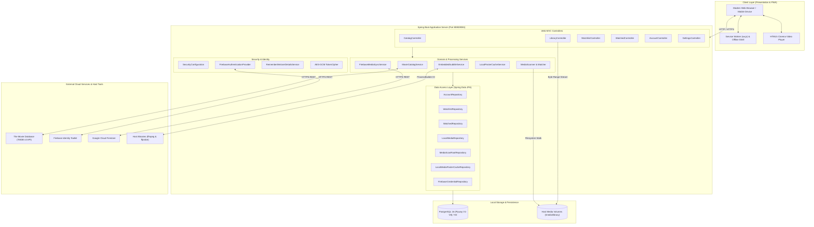
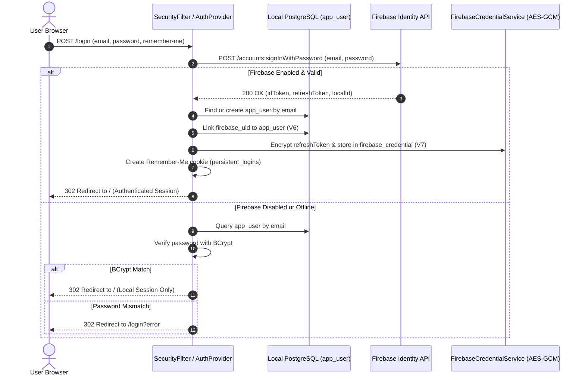
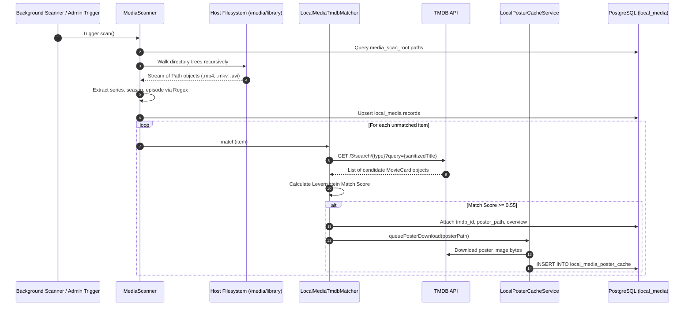
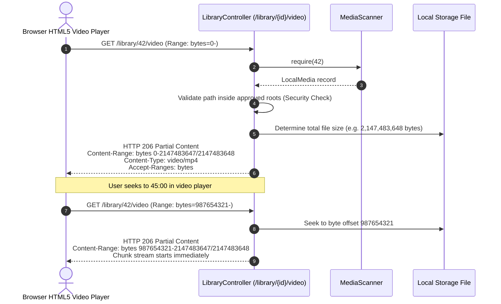

# Software Architecture & Technical Design Document
## Movie Watchlist Web Application

**Document Version:** 1.0.0  
**Project:** Movie Watchlist Web (`com.segi.watchlist`)  
**Architecture Pattern:** Layered Spring MVC / Hexagonal Ports-and-Adapters for External Services  
**Date:** October 2026  
**Status:** Approved / Baselined  

---

## 1. Architectural Overview

Movie Watchlist Web is architected as an autonomous, cloud-synced, offline-resilient media management platform. It combines server-rendered responsive web presentation (Spring Boot + Thymeleaf) with specialized background processing for local filesystem indexing, hardware-efficient media streaming, and real-time subtitle transcoding.

### Core Design Principles
1. **Separation of Concerns:** Business logic, data persistence, cloud integrations, and media handling are partitioned into distinct, decoupled Spring packages.
2. **Zero-Copy Media Streaming:** High-bandwidth media streaming bypasses database bloat by using the operating system's filesystem directly via Spring's `ResourceRegion` and RFC 7233 byte-range protocols.
3. **Subprocess Isolation:** Heavy multimedia inspection (`ffprobe`) and text stream extraction (`ffmpeg`) are sandboxed into bounded external processes rather than loading native shared libraries into the JVM memory space.
4. **Cloud-Hybrid Synchronization:** The application operates on a "local-first, cloud-synchronized" paradigm. User lists and metadata reside in a local relational database (PostgreSQL/H2) for instant response times and offline capability, synchronizing bidirectionally with Google Cloud Firestore when connectivity permits.

---

## 2. High-Level System Architecture

The following diagram illustrates the primary subsystems, boundary layers, and data flow of the application:



---

## 3. Subsystem & Component Decomposition

### 3.1 Security & Authentication Subsystem (`com.segi.watchlist.security`)
- **`SecurityConfiguration`**: Central security filter chain definition. Configures:
  - Public routes: `/`, `/search`, `/movie/**`, `/tv/**`, `/login`, `/signup`, `/css/**`, `/js/**`, `/images/**`, `/sw.js`, `/offline.html`.
  - Conditional routes: `/library/**` made public when `library.public-preview=true`.
  - Protected routes: `/watchlist/**`, `/watched/**`, `/profile/**`, `/settings/**`.
- **`FirebaseAuthenticationProvider`**: Authenticates credentials against Firebase Identity Toolkit if configured; falls back to local database credentials hashed with `BCryptPasswordEncoder`.
- **`RememberMeUserDetailsService`**: Backs the persistent "Keep me signed in" feature using `persistent_logins` table and AES-GCM encrypted refresh tokens stored in `firebase_credential`.
- **`NoStoreHtmlFilter`**: Injects `Cache-Control: no-cache, no-store, max-age=0, must-revalidate` on all HTML responses to prevent sensitive user pages from being stored in shared browser caches.

### 3.2 Catalog & Media Discovery Subsystem (`com.segi.watchlist.catalog`)
- **`MovieCatalogService`**: Encapsulates all communications with the TMDB v3 API. Performs server-side HTTP calls via Spring's `RestClient`.
  - Transforms raw TMDB JSON payloads into domain records: `MovieCard`, `MovieDetails`, `SeasonCard`, `MediaRail`.
  - Aggregates multi-rail discovery pages (Trending, Popular, Top-Rated, Upcoming).
  - Handles parameter validation and graceful error fallback (`TmdbNotConfiguredException`).

### 3.3 Local Media & Cinema Player Subsystem (`com.segi.watchlist.library`)
- **`MediaScanner`**: Performs recursive directory traversal across all roots declared in `media_scan_root`.
  - Filters video formats: `.mp4`, `.mkv`, `.avi`, `.webm`, `.mov`, `.m4v`.
  - Parses episode identifiers using regex patterns (e.g., `S01E04`, `1x04`, `Season 1 Episode 4`).
  - Detects deletions and prunes stale records.
- **`LocalMediaTmdbMatcher`**: Computes normalized Levenshtein edit distance between sanitized local video filenames and TMDB catalog searches. Automatically attaches TMDB IDs and overview descriptions when confidence $\ge 0.55$.
- **`LocalPosterCacheService`**: Downloads posters from TMDB for matched local items, storing the binary data in PostgreSQL (`local_media_poster_cache`). Serves them locally with HTTP 304 caching support.
- **`EmbeddedSubtitleService`**: Manages external FFmpeg/ffprobe processes:
  - Spawns `ffprobe` to inspect media containers for text subtitle streams (SubRip, ASS, Mov_Text).
  - Spawns `ffmpeg` on demand to convert selected subtitle streams directly to WebVTT (`text/vtt`).
- **`LibraryController`**: Serves UI views, poster images, range-based video streams, and subtitle streams.

### 3.4 Watchlist & Watched Subsystem (`com.segi.watchlist.watchlist`, `com.segi.watchlist.watched`)
- **`WatchlistService`**: Manages user intention to watch titles. Enforces unique constraints per `(user_id, tmdb_id, media_type)`.
- **`WatchedService`**: Manages viewing logs, watched timestamps, and user ratings (1 to 5 stars).
- Automatically triggers synchronization events through the Cloud Sync subsystem.

### 3.5 Cloud Synchronization Subsystem (`com.segi.watchlist.cloud`)
- **`FirebaseMediaSyncService`**: Orchestrates two-way reconciliation between local PostgreSQL entries and Cloud Firestore documents.
- **`FirestoreRestClient`**: Lightweight REST client communicating directly with Firestore v1 REST endpoints without requiring the heavyweight Google Cloud SDK.
- **`TokenCipher`**: Cryptographic utility implementing AES-256-GCM authenticated encryption for persistent Firebase refresh tokens.

---

## 4. Key Workflows & Sequence Diagrams

### 4.1 Authentication & Session Federation Flow



### 4.2 Local Media Filesystem Scan & TMDB Metadata Match



### 4.3 HTTP 206 Byte-Range Video Streaming Pipeline



### 4.4 Dynamic Subtitle Transcoding Pipeline (FFmpeg to WebVTT)

```mermaid
sequenceDiagram
    autonumber
    actor Player as Cinema Player
    participant Ctrl as LibraryController
    participant SubSvc as EmbeddedSubtitleService
    participant FFprobe as ffprobe Subprocess
    participant FFmpeg as ffmpeg Subprocess
    participant Disk as Video File (.mkv)

    Player->>Ctrl: GET /library/42/subtitle/tracks
    Ctrl->>SubSvc: tracks(filePath)
    SubSvc->>FFprobe: Exec: ffprobe -show_entries stream=index,codec_name:stream_tags=language,title
    FFprobe->>Disk: Probe container metadata
    FFprobe-->>SubSvc: JSON stream list
    SubSvc->>SubSvc: Filter text codecs (subrip, ass, mov_text)
    SubSvc-->>Ctrl: List of SubtitleTrack(index, language, title)
    Ctrl-->>Player: 200 OK JSON (Available Tracks + External Sidecars)

    Player->>Ctrl: GET /library/42/subtitle/embedded/2 (Track #2 selected)
    Ctrl->>SubSvc: streamWebvtt(filePath, trackIndex=2)
    SubSvc->>FFmpeg: Exec: ffmpeg -i <file> -map 0:2 -f webvtt -
    FFmpeg->>Disk: Read packet stream #2
    FFmpeg-->>SubSvc: WebVTT formatted stdout stream
    SubSvc-->>Ctrl: Pipe stdout stream
    Ctrl-->>Player: HTTP 200 text/vtt;charset=UTF-8<br/>WEBVTT... cues
```

---

## 5. Security Architecture

### 5.1 Defense-in-Depth Measures
1. **Path Traversal Mitigation (`checkedPath`):**
   Any file streaming or subtitle request verifies that the resolved canonical path begins with one of the configured `media_scan_root` prefixes. Requests containing relative traversals (`../`) or attempts to access system directories outside defined roots are rejected with HTTP 400 Bad Request or HTTP 404 Not Found.
2. **Secure Token Storage:**
   Firebase refresh tokens are sensitive long-lived credentials. They are never written to the database in plain text. `TokenCipher` uses AES-GCM with a 128-bit initialization vector (IV) unique to every record, producing an authenticated ciphertext payload.
3. **HTTP Cache Isolation:**
   `NoStoreHtmlFilter` enforces `no-store` policies across dynamic Thymeleaf endpoints, guaranteeing that HTML containing user collection counts, email addresses, or personal ratings cannot be recalled from intermediate proxies or browser history on shared terminals.
4. **CSRF Protection:**
   State-altering actions (watchlist additions, deletions, rating updates, title overrides) are protected by Spring Security's synchronized CSRF token repository.

---

## 6. Performance & Resource Optimization

### 6.1 Low-CPU Design
- **No Video Re-Encoding:** The server performs zero real-time video transcoding. Playback relies exclusively on the browser's native hardware decoder through HTTP byte-range slicing.
- **Asynchronous TMDB Poster Caching:** TMDB poster downloads happen in the background during library scans. Images are stored in PostgreSQL once and served thereafter with long-lived private cache headers (`Cache-Control: max-age=86400, private`), completely insulating the server from redundant external network requests.
- **Direct Subprocess Streaming:** Embedded WebVTT subtitles are piped directly from FFmpeg's standard output to the HTTP response output stream without writing intermediate files to disk, eliminating disk I/O bottlenecks.

---

*End of Architecture & Technical Design Document.*
