# Database & Data Model Specification
## Movie Watchlist Web Application

**Document Version:** 1.0.0  
**Project:** Movie Watchlist Web (`com.segi.watchlist`)  
**Engines:** PostgreSQL 16+ (Standard) / H2 Database Engine (Portable/Preview)  
**Schema Manager:** Flyway Database Migrations (`db/migration`)  
**Date:** October 2026  
**Status:** Approved / Baselined  

---

## 1. Database Architecture Overview

The Movie Watchlist persistence architecture is engineered for low latency, offline autonomy, and seamless cloud synchronization. It consists of two synchronized layers:
1. **Local Relational Store (PostgreSQL / H2):** The primary operational database accessed by Spring Data JPA. It maintains local user records, full watchlist/watched state, the scanned media library index, cached posters, and session credentials.
2. **Cloud Document Store (Google Cloud Firestore):** The distributed multi-device synchronization layer. It replicates user watchlists and ratings across devices using Firestore security rules.

Schema evolution is strictly managed through **Flyway versioned migration scripts** (`V1` to `V8`).

---

## 2. Entity-Relationship Diagram (ERD)

```mermaid
erDiagram
    APP_USER ||--o{ WATCHLIST_ENTRY : "owns"
    APP_USER ||--o{ WATCHED_ENTRY : "owns"
    APP_USER ||--o| FIREBASE_CREDENTIAL : "links"
    APP_USER ||--o{ PERSISTENT_LOGINS : "maintains"
    
    LOCAL_MEDIA }o--o| LOCAL_MEDIA_POSTER_CACHE : "references"
    LOCAL_MEDIA ||--o| MEDIA_SCAN_ROOT : "originates_from"

    APP_USER {
        bigint id PK "GENERATED BY DEFAULT AS IDENTITY"
        varchar email UK "RFC 5322 Email (max 254)"
        varchar display_name "Display Name (max 80)"
        varchar password_hash "BCrypt Password Hash (100)"
        varchar firebase_uid UK "Firebase Auth UID (128)"
        timestamptz created_at "Account creation timestamp"
    }

    WATCHLIST_ENTRY {
        bigint id PK "GENERATED BY DEFAULT AS IDENTITY"
        bigint user_id FK "References app_user(id) ON DELETE CASCADE"
        bigint tmdb_id "The Movie Database Identifier"
        varchar media_type "Check: 'MOVIE' or 'TV'"
        varchar title "Original or Catalog Title (max 300)"
        varchar poster_path "TMDB relative poster path"
        varchar backdrop_path "TMDB relative backdrop path"
        varchar release_date "Format: YYYY-MM-DD (max 32)"
        numeric vote_average "Rating (4,2)"
        timestamptz created_at "Added to watchlist timestamp"
    }

    WATCHED_ENTRY {
        bigint id PK "GENERATED BY DEFAULT AS IDENTITY"
        bigint user_id FK "References app_user(id) ON DELETE CASCADE"
        bigint tmdb_id "The Movie Database Identifier"
        varchar media_type "Check: 'MOVIE' or 'TV'"
        varchar title "Original or Catalog Title (max 300)"
        varchar poster_path "TMDB relative poster path"
        varchar backdrop_path "TMDB relative backdrop path"
        varchar release_date "Format: YYYY-MM-DD (max 32)"
        numeric vote_average "Rating (4,2)"
        integer user_rating "Check: 1 to 5 stars, or NULL"
        timestamptz watched_at "Recorded watched timestamp"
    }

    LOCAL_MEDIA {
        bigint id PK "GENERATED BY DEFAULT AS IDENTITY"
        text file_path UK "Absolute Canonical Filesystem Path"
        varchar file_name "Basename with extension (600)"
        varchar display_title "Sanitized Title (400)"
        varchar media_kind "Check: 'MOVIE' or 'EPISODE'"
        varchar series_title "Parsed Series Name (300)"
        integer season_number "Season Index (0 for Specials)"
        integer episode_number "Episode Index"
        varchar episode_title "Parsed Episode Name (300)"
        text subtitle_path "Path to matching .srt/.vtt sidecar"
        bigint file_size "Size in bytes"
        timestamptz modified_at "File last modified timestamp"
        varchar title_override "User manual rename override (400)"
        timestamptz last_seen_at "Last verification timestamp"
        bigint tmdb_id "Matched TMDB ID"
        varchar tmdb_media_type "Matched: 'MOVIE' or 'TV'"
        varchar tmdb_title "Matched Official Title"
        text tmdb_overview "Synopsis from TMDB"
        varchar tmdb_poster_path "Poster path from TMDB"
        varchar tmdb_release_date "Release date from TMDB"
    }

    LOCAL_MEDIA_POSTER_CACHE {
        varchar tmdb_media_type PK "Composite PK: 'MOVIE' or 'TV'"
        bigint tmdb_id PK "Composite PK: TMDB ID"
        varchar poster_path "Remote TMDB poster path"
        varchar content_type "MIME Type (e.g. image/jpeg)"
        bytea poster_data "Binary Image Bytes"
        timestamptz cached_at "Cache timestamp"
    }

    PERSISTENT_LOGINS {
        varchar series PK "Spring Remember-Me Series (64)"
        varchar username "User Email Address (320)"
        varchar token "Hashed Session Token (64)"
        timestamptz last_used "Timestamp of last auto-login"
    }

    FIREBASE_CREDENTIAL {
        varchar email PK "User Email Address (254)"
        varchar firebase_uid "Firebase Auth UID (128)"
        varchar display_name "Display Name (80)"
        varchar refresh_token_encrypted "AES-GCM-256 Encrypted Token (1024)"
        timestamptz created_at "Creation timestamp"
        timestamptz updated_at "Update timestamp"
    }

    MEDIA_SCAN_ROOT {
        varchar path PK "Host absolute directory path (1000)"
        timestamptz added_at "Configured timestamp"
    }
```



---

## 3. Flyway Migration History & Schema Evolution

The database schema is constructed through versioned SQL scripts located in `src/main/resources/db/migration/`:

| Version | Script Name | Core Changes & Purpose |
| :--- | :--- | :--- |
| **V1** | `V1__create_account_and_watchlist_tables.sql` | Creates `app_user` for local authentication and `watchlist_entry` for user watchlists with uniqueness constraints. |
| **V2** | `V2__create_watched_entry_table.sql` | Introduces `watched_entry` tracking watched titles and star ratings ($1 \le \text{rating} \le 5$). |
| **V3** | `V3__create_local_media_library.sql` | Creates `local_media` storing indexed filesystem videos, episode regex metadata, and external subtitle paths. |
| **V4** | `V4__add_optional_tmdb_reference.sql` | Adds nullable TMDB columns (`tmdb_id`, `tmdb_media_type`, `tmdb_title`, `tmdb_overview`, `tmdb_poster_path`, `tmdb_release_date`) to `local_media`. |
| **V5** | `V5__create_local_media_poster_cache.sql` | Introduces `local_media_poster_cache` storing binary image data (`BYTEA`) for offline poster rendering. |
| **V6** | `V6__link_accounts_to_firebase_identity.sql` | Adds `firebase_uid` with a unique partial index to `app_user` for federated authentication. |
| **V7** | `V7__create_persistent_sign_in.sql` | Implements `persistent_logins` (Spring Security token store) and `firebase_credential` for encrypted refresh token persistence. |
| **V8** | `V8__create_media_scan_root.sql` | Introduces `media_scan_root` allowing users to configure dynamic directory paths for media scanning via UI settings. |

---

## 4. Comprehensive Data Dictionary

### 4.1 Table: `app_user`
Stores account identities for local authentication and links to Firebase federated users.
- `id` (`BIGINT`, PK, Auto-increment): Unique local user identifier.
- `email` (`VARCHAR(254)`, Unique, Not Null): RFC 5322 compliant email address.
- `display_name` (`VARCHAR(80)`, Not Null): User visible display name.
- `password_hash` (`VARCHAR(100)`, Not Null): BCrypt salted hash of user password.
- `firebase_uid` (`VARCHAR(128)`, Nullable): Linked Firebase Authentication UID. Indexed via unique partial index `app_user_firebase_uid_unique` where `firebase_uid IS NOT NULL`.
- `created_at` (`TIMESTAMPTZ`, Not Null, Default `CURRENT_TIMESTAMP`): Account creation timestamp.

### 4.2 Table: `watchlist_entry`
Tracks titles saved by users to watch in the future.
- `id` (`BIGINT`, PK, Auto-increment): Entry ID.
- `user_id` (`BIGINT`, FK, Not Null): References `app_user(id)` with `ON DELETE CASCADE`.
- `tmdb_id` (`BIGINT`, Not Null): External TMDB media ID.
- `media_type` (`VARCHAR(16)`, Not Null): Must be `'MOVIE'` or `'TV'` (`CHECK (media_type IN ('MOVIE', 'TV'))`).
- `title` (`VARCHAR(300)`, Not Null): Catalog title.
- `poster_path` (`VARCHAR(300)`, Nullable): Relative path on TMDB CDN.
- `backdrop_path` (`VARCHAR(300)`, Nullable): Relative backdrop image path.
- `release_date` (`VARCHAR(32)`, Nullable): Release date string.
- `vote_average` (`NUMERIC(4,2)`, Nullable): TMDB community score.
- `created_at` (`TIMESTAMPTZ`, Not Null, Default `CURRENT_TIMESTAMP`): Timestamp added.
- **Constraints & Indexes:**
  - `CONSTRAINT watchlist_entry_unique_media UNIQUE (user_id, tmdb_id, media_type)`: Prevents duplicate entries.
  - `INDEX watchlist_entry_user_created_idx ON watchlist_entry (user_id, created_at DESC)`: Optimizes user watchlist queries.

### 4.3 Table: `watched_entry`
Tracks titles marked as watched and user-assigned quality ratings.
- `id` (`BIGINT`, PK, Auto-increment): Entry ID.
- `user_id` (`BIGINT`, FK, Not Null): References `app_user(id)` with `ON DELETE CASCADE`.
- `tmdb_id` (`BIGINT`, Not Null): External TMDB media ID.
- `media_type` (`VARCHAR(16)`, Not Null): `'MOVIE'` or `'TV'`.
- `title` (`VARCHAR(300)`, Not Null): Catalog title.
- `poster_path`, `backdrop_path`, `release_date`, `vote_average`: Cached TMDB attributes.
- `user_rating` (`INTEGER`, Nullable): User rating between 1 and 5 stars (`CHECK (user_rating IS NULL OR user_rating BETWEEN 1 AND 5)`).
- `watched_at` (`TIMESTAMPTZ`, Not Null, Default `CURRENT_TIMESTAMP`): Watched record timestamp.
- **Constraints & Indexes:**
  - `CONSTRAINT watched_entry_unique_media UNIQUE (user_id, tmdb_id, media_type)`.
  - `INDEX watched_entry_user_date_idx ON watched_entry (user_id, watched_at DESC)`.

### 4.4 Table: `local_media`
The index of discovered video files on the local filesystem.
- `id` (`BIGINT`, PK, Auto-increment): Primary key.
- `file_path` (`TEXT`, Unique, Not Null): Absolute canonical path on disk.
- `file_name` (`VARCHAR(600)`, Not Null): File basename with extension.
- `display_title` (`VARCHAR(400)`, Not Null): Sanitized human-readable title.
- `media_kind` (`VARCHAR(16)`, Not Null): `'MOVIE'` or `'EPISODE'`.
- `series_title` (`VARCHAR(300)`, Nullable): Parsed show title for episodes.
- `season_number` (`INTEGER`, Nullable): Numerical season index.
- `episode_number` (`INTEGER`, Nullable): Numerical episode index.
- `episode_title` (`VARCHAR(300)`, Nullable): Episode name if present in filename.
- `subtitle_path` (`TEXT`, Nullable): Absolute path to matching external `.srt` or `.vtt` file.
- `file_size` (`BIGINT`, Not Null): File size in bytes.
- `modified_at` (`TIMESTAMPTZ`, Not Null): Filesystem modification timestamp.
- `title_override` (`VARCHAR(400)`, Nullable): User manual correction from the UI.
- `last_seen_at` (`TIMESTAMPTZ`, Not Null, Default `CURRENT_TIMESTAMP`): Verification scan timestamp.
- `tmdb_id`, `tmdb_media_type`, `tmdb_title`, `tmdb_overview`, `tmdb_poster_path`, `tmdb_release_date`: Matched TMDB metadata.
- **Indexes:**
  - `INDEX local_media_kind_title_idx ON local_media (media_kind, display_title)`: Fast shelf retrieval.
  - `INDEX local_media_episode_order_idx ON local_media (series_title, season_number, episode_number)`: Fast season ordering.

### 4.5 Table: `local_media_poster_cache`
Stores raw poster bytes locally in PostgreSQL for fast, offline-capable image rendering.
- `tmdb_media_type` (`VARCHAR(16)`, PK): `'MOVIE'` or `'TV'`.
- `tmdb_id` (`BIGINT`, PK): TMDB identifier.
- `poster_path` (`VARCHAR(300)`, Not Null): Remote TMDB path.
- `content_type` (`VARCHAR(100)`, Not Null): MIME type (`image/jpeg`, `image/png`).
- `poster_data` (`BYTEA`, Not Null): Binary payload of the image.
- `cached_at` (`TIMESTAMPTZ`, Not Null, Default `CURRENT_TIMESTAMP`): Download timestamp.

### 4.6 Table: `persistent_logins`
Standard Spring Security persistent remember-me token repository.
- `series` (`VARCHAR(64)`, PK): Unique session series identifier.
- `username` (`VARCHAR(320)`, Not Null): User email.
- `token` (`VARCHAR(64)`, Not Null): Current random token hash.
- `last_used` (`TIMESTAMPTZ`, Not Null): Timestamp of last successful automatic login.

### 4.7 Table: `firebase_credential`
Stores encrypted Firebase refresh tokens to allow persistent background synchronization.
- `email` (`VARCHAR(254)`, PK): User email.
- `firebase_uid` (`VARCHAR(128)`, Not Null): Firebase UID.
- `display_name` (`VARCHAR(80)`, Not Null): Display name.
- `refresh_token_encrypted` (`VARCHAR(1024)`, Not Null): AES-GCM-256 encrypted refresh token.
- `created_at`, `updated_at`: Audit timestamps.

### 4.8 Table: `media_scan_root`
Configured filesystem directories monitored by the background scanner.
- `path` (`VARCHAR(1000)`, PK): Canonical directory path.
- `added_at` (`TIMESTAMPTZ`, Not Null, Default `CURRENT_TIMESTAMP`): Addition timestamp.

---

## 5. Cloud Firestore Document Schema

When connected to Firebase, user lists are synchronized with Google Cloud Firestore using the following document layout:

```
/users/{firebase_uid}/
  ├── watchlist/{tmdb_id}_{media_type}
  │     ├── tmdbId: number
  │     ├── mediaType: string ("MOVIE" | "TV")
  │     ├── title: string
  │     ├── posterPath: string
  │     ├── backdropPath: string
  │     ├── releaseDate: string
  │     ├── voteAverage: number
  │     └── createdAt: timestamp
  │
  └── watched/{tmdb_id}_{media_type}
        ├── tmdbId: number
        ├── mediaType: string ("MOVIE" | "TV")
        ├── title: string
        ├── posterPath: string
        ├── backdropPath: string
        ├── releaseDate: string
        ├── voteAverage: number
        ├── userRating: number (1 to 5, or null)
        └── watchedAt: timestamp
```

### Security Rules (`firestore.rules`)
```javascript
rules_version = '2';
service cloud.firestore {
  match /databases/{database}/documents {
    match /users/{userId}/{document=**} {
      // Users may only read and write to documents under their own user ID
      allow read, write: if request.auth != null && request.auth.uid == userId;
    }
  }
}
```

---

## 6. Data Integrity & Maintenance Procedures

1. **User Deletion Cascades:** Deleting an `app_user` automatically deletes all child rows in `watchlist_entry` and `watched_entry` via foreign key `ON DELETE CASCADE`.
2. **Orphaned Poster Cleanup:** When local video files are deleted from the disk, the scanner prunes the `local_media` row. A scheduled maintenance task executes:
   ```sql
   DELETE FROM local_media_poster_cache c
   WHERE NOT EXISTS (
       SELECT 1 FROM local_media m 
       WHERE m.tmdb_id = c.tmdb_id AND m.tmdb_media_type = c.tmdb_media_type
   );
   ```
3. **Stale Session Expiration:** Rows in `persistent_logins` older than `security.remember-me.validity-seconds` (default: 30 days) are purged during scheduled maintenance or upon explicit logout.

---

*End of Database & Data Model Specification.*
